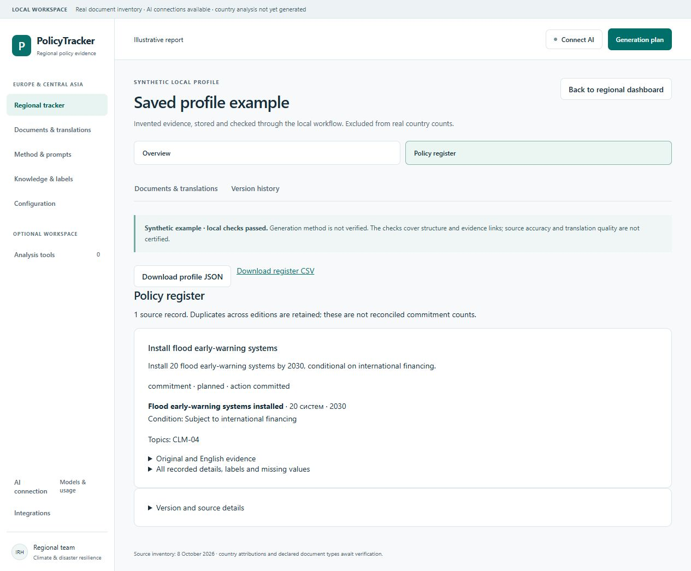

# Local architecture verification

9 October 2026. See [the implemented design and commands](../../docs/ARCHITECTURE.md).

The change adds a local save/check/display/export path for existing output bundles. It uses the existing Python application and SQLite, with no new dependency, worker service or external deployment. It does not claim to complete country generation.

## Automated checks

- **71 Python tests passed** in the final full discovery run. This includes nine new local-profile tests plus the existing method, integrity, storage and mocked AI-runtime checks.
- **24 JavaScript tests passed**, including two new saved-view checks for escaped evidence, version-bound export links, quantitative ranges, limitations and analyst-suggestion labels.
- All v2, methodology, operational and integration checks passed: 16 v2 schemas, 12 routes, 13 stages; two core views, 10 report sections and 20 exact Markdown sources; 18-country/42-document projection; 31 integration operations, 38 schemas and 10 read tools.

New profile tests cover frozen inputs after source/configuration edits, persistence across connections, rejection of fabricated quotations and broken scope/citations, failed-run history, immutable objects, corruption detection, late completions, new-source staleness, pin/unpin revisions, synthetic isolation, nested CSV data, bilingual evidence, and the read-only HTTP boundary. The CSV HTTP test checks the requested version and rejects exporting a synthetic version through the real-country scope.

A Windows socket reset was reproduced when an early origin rejection closed a POST with unread bytes. The server now consumes the bounded body before rejecting it; origin and CSRF checks remain mandatory. The existing HTTP suite passed after the fix, followed by the full Python suite.

Validation originally used a temporary directory; the bundled Windows runtime's restrictive temporary-directory permissions prevented access. The final design reads archived schema/configuration bytes directly in memory, avoiding those temporary files and keeping validation tied to the frozen context.

Commands used the existing bundled Python 3.12 and modern Node runtime documented in [the earlier verification note](method-review.md):

```powershell
python -m unittest discover -s tests
node --test --test-isolation=none tests/integration-client.test.mjs tests/operation-request.test.mjs tests/ai-client.test.mjs tests/profile-view.test.mjs
python scripts/check_v2_pack.py
python scripts/check_methodology.py
python scripts/check_operations.py
python scripts/check_integration_contracts.py
```

`--test-isolation=none` avoids the environment's subprocess restriction. No provider transport was called; AI tests used fake providers.

## End-to-end local exercise

`profile demo` created two immutable synthetic versions while the illustrative report was corrected. The second version accurately marks its scope, named lead agency, financing condition and synthetic-source limitation as found. The earlier fixture incorrectly marked those supported sections missing. Both versions remain in history; the newer checked version is selected.

The browser was inspected through the real loopback server. Verified:

- Regional saved-profile count stays **0/18**; synthetic data never enters real-country counts.
- Overview uses saved report sections and preserves finding kinds and limitations.
- Policy register displays the conditional 20-system/2030 target and the original/English evidence.
- The same profile ID appears in the view, history and CSV link.
- Version history survives reload and identifies the selected version.
- CLI JSON and CSV exports succeeded and round-tripped to the same version and complete record.



No original source PDF was changed, no real country profile was imported, no model calls were made and nothing was published externally. The local database is ignored by Git and blocked from static HTTP access. Existing AI connection work was preserved; only the shared HTTP rejection handling was corrected.

## Limits

These results verify software behavior. Imported model provenance is explicitly unverified. Attribution/layout checks use preparer declarations; source-segment correspondence to PDF content, semantic support, extraction recall and translation accuracy need further evaluation. The store keeps separate source records and does not invent canonical cross-edition identities. Country workers, OCR/table reconstruction, translation generation, reconciliation and hosted publication remain outside this implementation.
