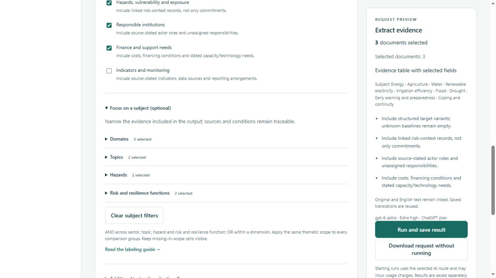
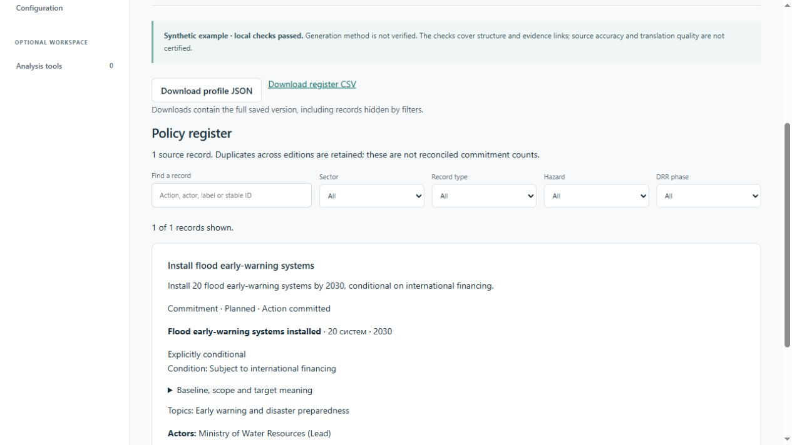

# Method review verification — 9 October 2026

## Lean method 3.0 implementation

The approved simplification is implemented across authoritative configuration, extraction/relabeling prompts, generated contracts/catalogs, local validators, request composition, register/readers, filters and exports. The [methodology](../../docs/METHODOLOGY.md) contains all changed old/new options and worked examples; the [generated codebook](../../docs/knowledge/labeling-guide.md) defines every current option.

- One statement type replaces three classifications; one optional function pool replaces DRR/resilience columns. Policy labels, linked facts and evidence metadata have separate codebook sections.
- Multiple topics derive overlapping domains without copying records or allocating shared finance. Prompts distinguish independent actions, linked target variants, source authority, time, negation, generic resilience and hazard/function co-occurrence.
- Material field gaps use not stated, ambiguous or not applicable. Conflicts retain values and relationships; processing limitations belong to coverage/issues. New schema/validation rejects obsolete fields and invalid gap locations.
- Archived schemas and codebooks retain their original meaning. Frozen synthetic legacy fixtures exercise reading, validation, exports and cross-version filter rejection. No archived country profile or source document was migrated.
- Domain/topic/hazard/function checkboxes in Analysis tools support multiple selections, show selected counts, preserve every selection in the downloadable request, and clear together. Operational request version is 2.0.0; method versions are 3.0.0.

Browser verification used port 8766 with a separate `tmp/lean-ui.sqlite3` database. It verified the 41-topic codebook, nine statement types, eight functions, readable labeling example, one statement column, current/legacy handling through automated cases, original/English evidence and relevant gap details. Two risk functions returned five distinct records; adding Flood narrowed them to three. A downloaded, unexecuted request retained 3 domains, 2 topics, 2 hazards and 2 functions and passed the operational JSON Schema. Clearing filters restored all evidence. No browser errors were reported.



The full offline check uses Python 3.12 and Node 24+:

```powershell
python scripts/check_project.py --local-data --node <Node-24-or-newer-executable>
```

Final result: **120 Python tests and 53 JavaScript tests passed**, together with all contract, integration, method and presentation checks. SHA-256 fingerprints for all 42 source PDFs matched the inventory; the existing local profile database passed read-only integrity/reference checks. The final log is local scratch output at `tmp/lean-final-check.log`. The downloaded browser request is retained locally at `tmp/lean-browser-request.json`.

Duplicate labels are rejected locally, keeping the generated model schema within the documented [Structured Outputs subset](https://developers.openai.com/api/docs/guides/structured-outputs#supported-schemas). No live provider calls were used to test this boundary. The source-text spot review supporting CLM-08 is documented in the methodology; software and synthetic tests do not establish real-model extraction accuracy.

Restart an already-running local server before starting work with the revised method. New runs use the new contracts; incompatible old checkpoints must not be resumed as if their method were unchanged. This verification did not start real country processing or alter stored evidence, credentials or model settings.

See the [current findings and workflow](../../docs/METHOD_REVIEW.md) and [customization guide](../../docs/CUSTOMIZATION.md). This review used local fixtures and fake providers. No model/API spending, real country processing, external publication or source-PDF edits occurred.

## Follow-up: simple source records and comparison

The user's scope correction is recorded in the README and method guide: improve extraction, analysis and representation through the existing pipeline. Additional AI review and automatic merging are deferred, not prerequisites. The reconciliation, Overview and optional comparison prompts now distinguish supported numeric changes, descriptive differences and unresolved meaning, with citations to both sides. No route, schema, service or model call was added.

The register now shows each record's source title/pages, calls displayed counts source records, and names records/sources in proposed relationships. A regression case verifies that repeated statements remain two unmodified records with distinct source locators and a preserved unresolved relationship. Eight targeted JavaScript tests passed. Method-pack rebuilding, methodology, v2 and operational composition checks passed; all 20 displayed Markdown sources match their authoritative bytes.

An isolated fake-provider browser preview verified source/page display, a zero-match filter count and restoration, and the deferred-check wording. Screenshot: [source records](source-records-2026-10-09.jpg). These checks do not measure real LLM comparison quality; no country trial was run. Earlier full-suite results below belong to the broader review.

## Results

| Check | Result |
|---|---|
| Initial Python baseline | 71 passed |
| Full Python discovery after corrections and concurrent worker additions | 90 passed, including 6 new evidence/customization/archive regressions and 13 independently added country-worker tests |
| JavaScript suites | 34 passed: integration, operational requests, AI client, generation display, saved profile display/filtering and configuration editor |
| Five customization examples | Existing isolated-workspace test validates/applies/rebuilds a prompt edit, new topic, revised definition, supported option change and explanatory UI text; checks schemas, composer and generated catalogs |
| `method_pack.py build` | Validation and all derived generators passed; editable source files retained |
| `check_contracts.py` | 12 top-level schemas, 40 legacy topics, 9 v1 routes passed |
| `check_v2_pack.py` | 16 schemas, 12 configured routes, 13 declared stages and 3 synthetic outputs passed |
| `check_methodology.py` | Two views, 10 sections and 13 stages mapped; all 20 displayed Markdown sources byte-identical to authoritative files |
| `check_operations.py` | 18-country/42-document projection, five requests/compositions and pending-upload rejection passed |
| `check_integration_contracts.py` | 31 blueprint operations, 38 schemas and 10 read-tool contracts passed |
| Original source preservation | SHA-256 recomputed: all 42 PDFs match the corpus manifest |
| Browser instruction fingerprint | Displayed operational extraction instructions hash to `60d158045094e9acdb0ae1bf930cb75655e62bf655c3a91aaac15b41178fc0f8`, matching the configured assembly |

The six new Python cases cover signed/grouped/exponent numeric substring errors, typed-detail evidence, follow-up citation joins, retained contextual evidence, archived codebook stability and unsupported semantic enum changes. New JavaScript cases cover Overview priorities/questions/context, filters across archived cross-sector relationships, and exact CRLF/mixed-ending restoration. Existing tests also cover quotation/country checks, pinning, immutable exports, stale packages, CSV round-trip and no silent model fallback.

The saved profile validator version is now `local-profile-2`. Existing completed receipts remain unchanged; they are not retroactively certified by the new checks. An already prepared import detects validator code changes and requires a new preparation. The country worker also rejects incompatible method changes on resume.

## Reproduction commands

Use Python 3.10+ with project dependencies and current Node. This workstation's default Python 3.9 and old Node could not run the project; existing bundled runtimes/local packages were used without installation:

```powershell
$reviewPython = 'C:\Users\Meriç\.cache\codex-runtimes\codex-primary-runtime\dependencies\python\python.exe'
$reviewNode = 'C:\Users\Meriç\.cache\codex-runtimes\codex-primary-runtime\dependencies\node\bin\node.exe'
$env:PYTHONPATH = 'D:\PolicyTracker\src;D:\PolicyTracker\tmp\python-deps'
$env:PYTHONIOENCODING = 'utf-8'

& $reviewPython scripts/build_v2_examples.py
& $reviewPython scripts/method_pack.py build
& $reviewPython scripts/check_contracts.py
& $reviewPython scripts/check_v2_pack.py
& $reviewPython scripts/check_methodology.py
& $reviewPython scripts/check_operations.py
& $reviewPython scripts/check_integration_contracts.py
& $reviewPython -m unittest discover -s tests -v
& $reviewNode --test --test-isolation=none tests/ai-client.test.mjs tests/integration-client.test.mjs tests/operation-request.test.mjs tests/generation-view.test.mjs tests/profile-view.test.mjs tests/config-editor.test.mjs
```

Only run the example generator to rebuild invented examples. It is not a country-processing command. Node isolation is disabled to accommodate this workstation's restricted child-process environment, without changing assertions.

## Rendered interface

Used an isolated loopback preview with a separate database in ignored `tmp/review-preview.sqlite3` and fake AI connection methods. The preview contained a synthetic saved profile with illustrative priority and follow-up rows. The user's `data/local-profiles/workspace.sqlite3` was not changed.

Verified at the existing browser viewport:

- Overview shows priorities and analyst questions; evidence expands to original Russian, stored machine English, original English metadata and linked context. English full segments are distinguished from exact quotations.
- Register shows named topics, conditions and actors. Search returns a clear zero-result state, restoring the search restores the record, and selecting Climate retains the one record. Archived label definitions are readable. Full-version export scope is stated.
- Method & prompts explicitly distinguishes implemented worker stages from the absent source/report quality challenges. The ordered operational assembly and displayed fingerprint match the composer.
- Configuration clearly reports unchanged/draft/error states. Invalid JSON disables download. Restoring visible content now returns to unchanged with the exact original bytes. No draft was applied.
- Current Knowledge configuration has version labels; saved-profile meanings resolve from archived validation data rather than this current catalog.



No full accessibility or responsive-device audit was performed. Fake-provider tests and synthetic visual checks establish software behavior, not extraction recall, semantic entailment, original-language accuracy or real PDF table fidelity.

## Preservation and scope

A pre-edit code/config snapshot is retained in ignored `tmp/system-review-20261009-015221/`. There was no initial Git commit; all files were untracked. Independently added country-run/AI implementation and tests were preserved and included in compatibility checks, not presented as review-authored functionality. Historical profiles, original PDFs and credentials were not edited.

The codebook and workflow still need representative source evaluation. The [review](../../docs/METHOD_REVIEW.md#remaining-work-in-recommended-order) separates completed fixes from those production gaps.
