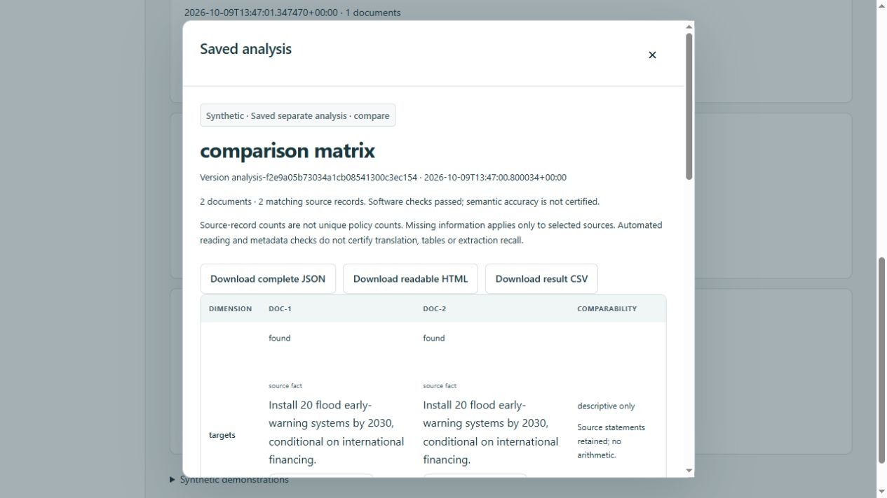

# Document-to-output workflow audit

9 October 2026. This report supersedes earlier statements that optional tasks only build requests. **Software connectivity and offline execution are demonstrated; real-model analytical quality is not certified.** After the initial offline audit, the user authorized the [five-page live evaluation](../../evals/workflow-live-results.md). It stopped after seven calls at the translation repair cap; the demonstrated advisory-note/defect contract mismatch was corrected and checked offline. No credential changes, real country generation, source replacement, or publication took place. The previews used isolated databases containing only invented examples. Existing source documents and historical workspace profiles were preserved.

The starting checkout had no tracked baseline: all project directories were untracked. Before editing, code/configuration/documentation snapshots were saved under `tmp/workflow-audit/before`; unrelated contents were not reset or cleaned. The full local-source check verifies the manifest's original fingerprints.

## Feature status

“Working offline” means actual worker/storage or UI behavior was exercised with synthetic responses. It does not mean a real provider or the model's interpretation has passed acceptance.

| Feature | Finding before audit → current status | Implementation and verification |
|---|---|---|
| Regional tracker, document availability | Working → working offline | `inventory.py`, generated workspace projection, `app.js`; real inventory has 18 countries, 42 PDFs, 2,670 physical pages, 17 countries with documents. Browser shows zero real saved profiles; synthetic outputs do not inflate counts. Availability is not policy quality. |
| Country selection and generation | Connected → working offline | `CountryRunner.start/run`, `/api/ai/country-runs`, `generation-view.js`; one-source fixture completes, has citations and single-source limits; invalid attribution/changed input stops. No real country was generated. |
| Overview / Policy register | Working → working offline | `profiles.py`, `profile-view.js`, `evidence-model.mjs`; record counts, target variants, risk/delivery perspectives, archived label meanings and original/English evidence remain distinct. Browser zero-match and history reading checked. |
| Document selection and source access | Selected IDs worked; original PDF access missing → working locally | Manifest resolution, hash checking and `/api/ai/documents/{version-or-current}/{document}`; session/origin protection, restricted registered/historical source lookup. No broad static data exposure. Synthetic non-PDF fixtures do not show a PDF link. |
| Extract evidence | Request-building only → working offline | `operations.py`, worker dispatch, separate result archive, selected-column table, citations, JSON/HTML/CSV. Default, every field selection and no-match scope covered by synthetic tests. |
| Compare policies | Request-building only → working offline, semantic eligibility provisional | Same worker; five modes, disjoint groups, triaged edition relationships, same scope, every selected dimension/group, correct-group citations and explanations. Equivalent editions reject before translation/extraction. Exact duplicate bytes reject before dispatch. Relationship meaning still needs real evaluation. |
| Implementation-information checks | Request-building only → working offline | Code computes selected lead/finance/indicator-baseline/deadline omissions per commitment; output must agree. Separate optional proposals must be cited and labeled. Missing extraction is not national absence or implementation failure. |
| Question-led brief | Request-building only → working offline | Required question, selected sections, optional follow-up questions, citation checks and saved result. Question relevance and usefulness require real evaluation. |
| Independent translation | Request-building only → working offline; first live sample blocked | Uses full registered-source preparation/triage/translation, bypasses extraction and country completion. Live evaluation exposed advisory notes in blocking flags; separate notes now persist/display/export, with genuine defects still blocking. Corrected contract is not yet live-verified. |
| Evidence inspection and historical citations | Partly connected → working locally | Source/segment/record joins checked; version-specific profile JSON fixed; archived original bytes and frozen method downloadable. Browser opened bilingual evidence. Semantic citation support remains a model/human acceptance issue. |
| Task filters, fields and defaults | Composed but did not execute → working offline | Deterministic AND across dimensions / OR within each; options consume authoritative task configuration. Omission uses defaults, explicit empty required field list fails, false stays false, no-match stays empty. |
| Country reader customization | Working → working offline | Named views, column visibility, search, independent facets, same-variant target matching, sort/group, filtered/full exports; browser zero-match verified. Saved narrative is explicitly full-scope and not regenerated by filtering. |
| AI connection, route/model/effort | Connected transport → exact selection confirmed on seven live requests | `ai_runtime.py`, session/CSRF routes, account/API isolation, catalog validation, mismatch checks, usage receipts, no fallback. All seven evaluation receipts confirm ChatGPT / GPT-6 Astra / xhigh. No separate connection-test inference was made. |
| Configuration drafts/apply/defaults | Working → working offline | Browser draft/package remains separate from apply; method-pack validation, stale fingerprints, source rollback, build and frozen run method. Blueprint controls are not advertised as active execution. |
| Progress, stop, resume, restart | Country only → shared country/analysis worker, working offline | Existing job/step/attempt tables reused. Stop is a request boundary; validated response can be retained but no next call/result commit. Restart requires explicit resume; source/method/review changes require a new run. One active worker. |
| Compatible reuse | Working → working offline, deliberately strict | Signature includes exact packet, selection, worker/method and synthetic scope; cached output revalidated. Repeated standalone translation performs no new translation call in the fixture. Cross-scope reuse is not promised. |
| History/read/pin/unpin | Historical CSV/CLI selection worked; UI/JSON incomplete → working locally | Exact version JSON and archive, UI read/pin/unpin, optimistic selection revision. Browser pinned older synthetic version, read it, then unpinned to latest. Failed runs never replace a checked profile. |
| Analysis history/display/export | Missing → working offline and browser tested | `/api/ai/analyses`, `operations-view.js`; histories persist across restart. Completed-only result route; comparison matrix, gaps table, brief/extraction narrative, bilingual annex. Comparison CSV now exports the matrix, not an unrelated evidence projection. Empty extraction export stays empty. |
| Conditional OCR / unreadable pages | Low-text stop only → conditional preparation implemented, real engine acceptance pending | `preparation.py`, `prepare_document.py`; sparse/damaged/rotated/raster flags, source/page/hash-bound reviewed text or nontext receipts, optional Poppler/Tesseract candidate/render/TSV. No silent omissions or PDF rewriting. Tesseract unavailable; actual OCR quality untested. |
| Pending uploads | Intentionally pending / partially connected | Browser can describe pending files; it cannot invent registered IDs or execute them. Register via the existing corpus inventory workflow first. No unattended upload ingestion service added. |
| Hosted sharing, multiuser preferences, batch scheduler, canonical commitment registry, automatic parallel-translation matching, partitioned synthesis, model quality reviewer | Intentionally deferred blueprints | `architecture/`, `config/product.json`, storage/API/MCP packs and broader pipeline policies are not the local runtime. No new service/DAG interpreter was added. |
| v1 method/release registry; design-only optional reports | Legacy / demonstrations | v1 prompts/schemas and `releases.py` remain background. Invented report fixtures remain labeled; they are not completion receipts. Unused chat/relabel routes are not new promised UI workflows. |

## Actual flows, owners and failure behavior

| Stage | Owner; inputs → outputs | Dependencies / failure behavior |
|---|---|---|
| User setup | `app.js`, `analysis-view.js`, `generation-view.js`, `operation-request.mjs`; document IDs, task/options, selected route → validated request | Brief question and eligible comparison groups are required. Other focus is optional. Pending uploads/unknown IDs/invalid fields fail explicitly. Saving a request is not a run. |
| Dispatch gate | `local_server.py`, `CountryRunner.start`; same-origin session + CSRF + available exact selection → job | One active country/analysis at a time; no credential persistence or provider fallback. Requests/selected sources are frozen, not trusted browser metadata. |
| Freeze/preparation | `profiles.py` object store, manifest resolution, `prepare_sources`, `preparation.py`; original bytes + page reviews → physical pages/segments/checks | Hash/path mismatches, parser exceptions or unresolved page concerns stop before provider dispatch. Review commands report all physical pages. Worker error gives the full inspection command before the bounded error detail. |
| Triage/eligibility | `02-triage.md`, `operation_metadata`; first three + last two segment samples → country/instrument/date and relation proposals | Sample disclosure; country profiles reject non-national attribution. Comparison checks source-supported edition order, disjoint families and required instruments before translation/extraction. Sampling cannot independently certify authority or equivalence. |
| Translation | `03-translate.md`, independent supplement, translation schema; every owned segment → aligned English + source language + term decisions | Identity iff English, exact original identity, complete unique segment coverage, nonblank text/no quality flags. Other language and mixed-segment quality remain semantic. No thematic filtering in independent translation. |
| Extraction | `04-extract.md`, label guide, schemas, `validate_v2`; owned segments + adjacent/metadata context → records, evidence, coverage | Segment text capped at 6,000 characters with line breaks preferred; batches target 9,000 characters. Neighbour context supplements owned coverage. Quotes must resolve exactly once, numeric tokens normalize from original quotes, referenced details/context must belong to the record. Unknown labels, invented quotes, unresolved issues or skipped coverage fail. |
| Country analysis | reconciliation + prime routes; every record/quote → proposed links and Overview | No canonical winner/deduplication claim. Existing records/conditional variants preserved. Date order checked for before/after claims. Unsupported calculation objects rejected. Completeness is declared-scope processing, not parser recall. |
| Optional analysis | `scoped_evidence`, `delivery_checks`, task composition and validation → scoped extraction/matrix/checks/brief | Deterministic filters, group/citation joins, required dimensions/sections and proposal switches. Full extraction remains archived alongside scoped projection. No-match is visible and never broadened. Source/analyst interpretation distinction is validated structurally, not semantically certified. |
| Commit/history | `ProfileStore` or `save_operation`; fully validated result → immutable objects and checked profile/separate analysis | Transactions protect visible completion. Failed/stopped work does not publish or replace a valid selection. Disk-write failure releases the in-memory lock; persisted running jobs recover as stopped on restart. Physical disk-exhaustion/power-loss injection was not exercised. |
| Read/export | profile/analysis routes + renderers; explicit version → view, original/English reader, JSON/CSV/HTML | Reads cause no inference. `archive=1` expands actual method bytes, successful requests/responses and available attempts; imported generation remains unverified. Content is escaped; CSV protects formula-like cells. Selection uses optimistic revision. |

Country path: prepare → triage → translate every segment → extract every segment → reconciliation proposals → Overview → validate → immutable Country Profile → Overview/register/history/export.

Analysis path: prepare → triage/eligibility → translate → extract → code filters/checks → requested task synthesis → validate → independent saved analysis → reader/export/history. Independent translation exits after aligned translation and saves separate output. None of these optional outputs changes the published country selection.

## Settings and option effects

All task settings are preserved in the saved request. Exact model instructions and output schema bytes are available in the archive. Semantic effectiveness is still unverified; the checks below prove composition, deterministic behavior and output structure.

| Control / default | Stored/request value → consumer | Observable effect / checks |
|---|---|---|
| Selected country/documents | `document_ids` / `source_groups` → manifest + triage + worker | Original hashes/pages and country attribution change with selection. Same-source duplicate bytes rejected; cross-country selection rejected for a country run. |
| No particular focus / empty filter lists | `filters` arrays default empty → `scoped_evidence` | All extracted records retained. No optional topic is required to produce a general result. |
| Sector and topic | `domain_ids`, `topic_ids` → authoritative taxonomy + deterministic match | Each independently tested for matches/no matches; incompatible topic/sector rejects. Topic domains are derived from current frozen taxonomy, not model-generated labels. |
| Hazard and DRR phase | `hazards`, `drr_phases` → record label intersection | Independent positive/negative cases, OR within one dimension and AND across dimensions tested. No match produces no records, not a wider query. |
| Extraction fields | `requested_fields`: targets/risk/actors/finance on, indicators off → sections + `evidence_table` | Each field independently changes displayed/exported table columns while the complete evidence archive is retained. Explicit empty selection rejected; omitted selection uses configuration defaults. |
| Comparison priorities | targets/risk/finance on, actors/indicators off → requested dimensions | Every selected dimension exactly once; every group once per row. Each dimension independently tested. Same scope applies to all groups; comparability explanation required. |
| Documents / countries | `comparison_mode` → one document per group / one distinct country per group | Two or more groups required; tests exercise document, two-country and invalid single-country grouping. |
| Earlier/later | `revision` → same country/instrument, two editions, source-supported ordered dates | Reversed/unverified order and equivalent translations rejected; date precision must agree. Metadata sampling can fail legitimate difficult cases; do not invent order to force success. |
| NDC/NAP / custom groups | `ndc_nap` / `custom` → verified instruments / named exclusive assignments | Tests cover valid and contradictory instruments, duplicated assignments, empty/overlapping groups and equivalent editions. No incomplete group hidden from the matrix. |
| Information checks | gaps fields actors/finance/indicators/targets all on → `delivery_checks` | Every switch tested independently: fixture has a lead/deadline but lacks structured finance and indicators. Missing results therefore differ by selected check. This identifies missing extracted information, not verified absence in the full country. |
| Support proposals | `include_analyst_proposals=false` → validator + gaps renderer | False rejects proposals. True allows cited, labeled suggestions in separate columns. Enabled and disabled tested. No source-stated responsibility or deadline is synthesized from a proposal. |
| Brief question | nonblank `question` → briefing packet and result heading | Required because it defines the task. Empty is rejected. Browser entered a question and observed enabled action; switching to translation removed it. Answer relevance awaits live evaluation. |
| Brief fields | targets/risk/finance on, questions off → sections / follow-up allowance | Each switch changes saved section shape; follow-up suggestion rejected when off and accepted/labeled when on. |
| Translation instructions | `instructions` → independent translation task context + supplement | Terminology instructions reach the translation call. Translation allows no thematic filters or field lists. Changes alter the exact packet/cache signature; no reading-triggered inference. Meaning/fidelity awaits live evaluation. |
| Model / effort / usage route | `model.model`, `model.effort`, `model.route` → catalog and provider transport | Requested values reach dispatch; returned model/effort mismatches reject where provider confirms them. Requested and confirmed settings/usage remain separate. Unsupported choices do not silently fall back or switch billing. |
| Saved AI defaults | browser-local selected values → new form/request | Future form defaults only; actual selection frozen at start. Credential/session state is separate; reloading does not turn an expired connection into a verified one. |
| Configuration draft / exported package / apply | editor state → download → method-pack validation/apply/build | Draft has no execution effect until applied. Stale source fingerprints rejected, failed build rolls back source changes. Existing test suite proves prompt, taxonomy and option-default changes propagate. |
| Pipeline/translation policy, initial profile | `config/v2/pipelines.json`, `translations.json`, `initial-run-profile.json` | Prompt routes, required sections and translation instructions are consumed; the full pipeline graph, desired filenames/cache-key policy and initial 18-country run are descriptive specifications, not programmable worker controls. Actual worker remains explicit code. |
| Reader facets / views / columns | browser-local versioned view state → `evidence-model.mjs` | Presentation only; target condition/period must match one variant. No extraction/model call or history rewrite. Broader reader filters are not silently sent as generation filters. |

Restored saved requests are downloadable exact JSON. There is no separate “import arbitrary saved analysis request” UI promise; API submissions are validated afresh. Task switching clears question/terminology/proposal/group state and translation filters; it does not silently alter a frozen historical request.

## Prioritized fixes and prompt review

| Priority | Demonstrated problem | Fix |
|---|---|---|
| P1 | Analysis and translation UI stopped at request creation | Connected all five tasks to the existing worker, shared checkpoints and transport; added validated separate persistence, task-specific readers and exports. No new service/framework or real profile side effect. |
| P1 | Historical JSON ignored requested version, while CSV supported it | Version-bound JSON lookup, country/synthetic-scope checks, historical UI selection/pinning, and expanded archived method/requests/attempts. |
| P1 | Readable text could conceal substantive image material; low-character blanks prevented progress | Conditional raster/rotation/corruption signals, explicit reviewed text/nontext/OCR path, original-preserving derived artifacts and strict receipt checks. Actual corpus evidence below. |
| P1 | Task options were composed but had no validated execution/output effects | Default normalization, deterministic scope/projection/checks, group eligibility, required sections/dimensions and proposal/citation joins; individual-switch regressions. |
| P1 | Generic derived-finding rule required arithmetic even for qualitative interpretation | Shared contract now distinguishes qualitative `derived` interpretation from computed values. Current runtime rejects unverified calculation objects; comparison remains descriptive with source values and accounting caveats. No new arithmetic engine invented. |
| P1 | Translation could lose source-language identity; metadata-only English classification mishandled mixed pages | Required per-segment `source_language`, exact English identity, mixed-language handling and retained terminology decisions. Generator, schemas, examples and contracts rebuilt together. |
| P2 | Workplan prompt referred to a canonical layer the local worker does not create | One row per source commitment with exact application missing-information checks; proposal labels preserved. Repeated source statements remain source records. |
| P2 | Generic report requirements and optional sections conflicted | Operation supplement owns requested sections/group/dimension order; complete filtered evidence is supplied once, not re-filtered by prose instructions. Explicit no-match and disabled-option behavior. |
| P2 | Comparison CSV exported evidence projection; empty extraction fell back to source rows | Task-specific CSV selection and empty-result regression coverage. |
| P2 | Failed final write could leave connection/worker permanently busy | Nested final cleanup always releases in-memory status/active lock; restart recovery remains conservative. |
| P2 | Current documentation/configuration claimed transport/storage were missing | Updated architecture, methodology, task specification, experience handoff, customization pointers, data guide and authoritative translation status, then rebuilt outputs. |

Reviewed active shared evidence/label contracts; triage, translate, extraction, reconciliation, prime, focused, comparison, workplan and briefing routes; six operation supplements; generated schemas and exact composed packets in tests. Relabel/chat prompts were inspected as nonexecuted local routes. Source documents are JSON data under `untrusted_source_data`; embedded instructions cannot change route/model/scope, and prompt-injection tests preserve that separation.

Requests are bounded at 180,000 serialized UTF-8 bytes; source chunks are not silently truncated. Repairs include prior output/errors and are capped at two per step. Provider failures stop for explicit resume rather than repeat spending. Synthesis compaction removes empty/bookkeeping fields while retaining every record and quote; raw extraction remains archived. There is no measured accuracy, monetary saving or latency improvement claim. The only measured reuse result is the synthetic repeated translation making one translation call across the stop/resume/repeat scenario.

## OCR decision from this corpus

OCR/transcription is **conditionally necessary**. The audit sampled first/middle/last pages of every PDF plus all 67 inventory-flagged pages: 177 unique text samples and 77 rendered pages reviewed in seven contact sheets. Five additional Belarus evaluation pages were rendered later. The probe and per-page results are under `tmp/workflow-audit/` (`corpus-probe.json`, `pages-1.png` … `pages-7.png`, `eval-pages.png`). This was a representative inspection, not a page-by-page certification of all 2,670 pages.

| Observed source/page | Evidence and decision |
|---|---|
| Albania NAP `doc-479fa14721aeb6b3`, physical p113 | Render contains a dense substantive action-plan table; text extraction recovers only a page-number-sized fragment. Actual missing text requires reviewed OCR/transcription. Never mark it nontext. |
| Albania NAP p83, various Georgian dividers and Bosnian green pages | Sparse/empty layers can correspond to blanks or decorative separators. Use a visually justified nontext receipt; do not claim every low-count page needs OCR. |
| Armenia NAP cover; Serbian NAP cover; Uzbekistan cover | Scanned/partially extracted title material illustrates mixed/scanned inputs. Review source metadata and text before reuse. |
| Kyrgyzstan flagged pages 6/8/11 | PDFium recovered roughly 2,000 / 1,842 / 1,707 characters despite original low-text flags. Alternative text extraction/layout inspection may help; a character threshold alone does not prove OCR need. |
| Representative Albanian/Armenian/Kazakh table pages | Visually checked against extraction samples. Rows, columns, footnotes and inherited units still require acceptance review; linear text coverage does not certify table interpretation. |
| Belarus later NDC p3/5/9 and p12–25 | New raster/rotation signals catch graph/landscape material beyond old sparse-text flags. These are inspection signals, not established parsing failures. |

The local path renders a chosen page at 300 dpi with Poppler and requests Tesseract TSV with explicit language. It retains render/TSV, hashes, engine/language, confidence counts, extracted text and a warning. Candidate text is not accepted until reviewed. A manual UTF-8 transcription or explicit nontext receipt uses the same source/page hash guard. Original PDFs, filenames, document IDs and inventory hashes remain untouched. Receipt changes require a new run. Tesseract is not installed here, so real OCR execution/fidelity was not claimed; missing-engine and receipt-validation paths were tested. OCR does not solve every table or graph problem.

## Verification record

Full check command (project Python 3.12; bundled Node 24+):

```powershell
python scripts/method_pack.py build
python scripts/check_project.py --local-data --node <Node-24-executable>
```

Final result after the live-evaluation correction: **all offline project checks passed**, including **116 Python tests** (284.693 seconds) and **49 JavaScript tests**, contract/catalog checks, all **42 original PDF hashes**, 48 UI asset/import references and the existing database's read-only integrity/reference checks. `method_pack.py build` and synthetic example regeneration completed successfully. Full log: `tmp/workflow-post-evaluation-check.log`; the earlier 111-test audit log remains `tmp/workflow-final-check.log`. These automated checks made no live model calls. Key suites include country/operation runs, preparation, profiles, AI runtime, engineering, customization, system review, evaluation spending guards, and JavaScript reader/request/export tests.

| Acceptance scenario | Result and limit |
|---|---|
| One-document country | Passed synthetic real-worker path, persistence, citations, translations and two views; actual model usefulness unverified. |
| Multiple repeated/conflicting statements | Source preservation, relation references and reader variants covered by fixtures/tests; real duplicate/conflict recognition unverified. |
| All default tasks; each field/filter; enabled/disabled proposals | Executed synthetic worker/storage paths plus deterministic scope and output tests. A fake provider demonstrates wiring/contract, not model adherence. |
| Every comparison mode and bad groups | Passed synthetic mode/eligibility tests, overlapping/translation/reversed-order cases; returned cells constrained to correct sources. Real date/equivalence/comparability semantics unverified. |
| English/multilingual/numerical evidence | Identity, alignment, source-language contract, signed/grouped numbers, conditions, quote/coverage checks passed offline. Actual translation/extraction quality pending. |
| Preparation | Real corpus sampled visually; synthetic blank/rotated/raster/damaged signals, missing-engine failure, exact receipt hashes and nontext accounting tested. Real Tesseract recovery not exercised. |
| Stop/resume/restart/cache | Passed synthetic boundary and reuse tests; browser server restart retained five separate analyses. No live network interruption/power-loss exercise. |
| History/export/pinning | Historical JSON/CSV and archive regression; browser older-version read, pin/unpin and zero-match view passed. Original/English stored reading and English text download passed. CSV matrix, empty result, formula escaping and HTML escaping checked in JS. |
| Configuration activation/history | Method-pack/stale-source/rollback tests; changed method prevents old resume, saved archive exposes earlier method after a later edit. Existing historical profile bytes untouched. |
| Provider/validation/security failures | Mocked unavailable/partial/wrong-model/effort/cancel/account-switch paths; bounded invalid-output repairs, unknown citations, missing coverage, session/origin/CSRF guards. Disk-full and external service outages not empirically injected. |

Browser preview: `python scripts/preview_ui.py --port 8877 --profiles-path tmp/workflow-audit/ui.sqlite3`. Exercised regional counts, persisted analysis history, comparison matrix and bilingual citations, standalone saved translation/download, required question, task switching, disconnected-run failure, older version read/pin/unpin, register no-match. No model was connected. The screenshot below contains invented evidence and illustrates display connectivity only.

The final disconnected action returned “Connect your ChatGPT account first”; it created no job or inference. No console errors were captured in the final browser check. A session-authorized current-source PDF request for `doc-a2b2a58ff2573b05` returned 227,745 bytes with exactly its manifest SHA-256. Comprehensive cross-browser, accessibility and large-profile performance testing was not performed in this audit. The temporary preview was stopped after verification; its isolated database remains available for reproduction.



Post-evaluation reader check: an isolated `tmp/workflow-live-review/notes-ui.sqlite3` contained one new synthetic translation under the advisory-note contract. The bilingual reader displayed the notes, and the downloaded readable HTML retained them. The English-text download was not confirmed because browser automation timed out; it is not counted as passed in this second check. The earlier English-download check above belongs to the initial audit. Both preview sessions were stopped.

## Remaining blockers and next acceptance

1. **Live end-to-end acceptance remains blocked.** The original [seven-call result](../../evals/workflow-live-results.md) stopped before extraction. The separately authorized [eight-call follow-up](../../evals/workflow-followup-results.md) passed both translations on their first attempts and retained all 23 source-content distinctions in rejected extraction drafts, with 27/27 exact source quotations. Extraction still failed because advisory issues blocked acceptance; the earlier step exhausted its two repairs and the later repair exceeded the 180,000-byte packet limit. A quantitative conditional effect also survived only in prose and disappeared from the targets-only table. All five analytical tasks remain untested. The follow-up used a frozen pre-v3 method; newer concurrent workspace edits are not certified by it. No original repair cap was reset.
2. **Some real source sets need preparation before a full run.** Install/validate the local OCR engine or provide reviewed transcriptions, including Albania NAP p113; visually resolve flagged raster/rotated/blank pages. The complete Belarus preflight currently finds one flagged page in its earlier NDC and 17 in the later document. No silent pass was inserted.
3. **Semantic judgments remain judgments.** Citation IDs resolve, but support, omitted evidence, table associations, edition equivalence and wording quality need review. Record counts deliberately do not claim unique national commitments. Arithmetic transformations are not implemented; calculation objects are rejected and prompts request descriptive source-value comparisons. Unsupported arithmetic asserted in free prose still requires semantic evaluation.
4. **Documented local limits remain.** Pending uploads require registration; very large synthesis packets stop at the bound; official-parallel matching, universal OCR/table reconstruction, shared-hosted access and full batch publication are deferred. Optional result views are less customizable than the mature Country Profile reader.

The application now connects the promised registered-document local workflows through execution, validation, persistence, history, reading and export. That conclusion is about software behavior. It is not a claim that every real document is readable or that every model output is accurate.
