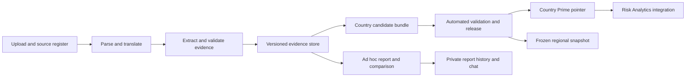

# Architecture and lifecycle

For the small implemented design, use [the working local architecture](ARCHITECTURE.md). This page describes the broader target lifecycle; its additional services are not prerequisites for the local MVP.

Target design updated 8 October 2026 for automatic publication and optional audit. The current `releases.py` reference code and v1 manifest schema still use the earlier approval model; they require coordinated migration before production. See `08-product-decisions-and-feature-scope.md` for the clarified decisions and feature boundaries.

## Service boundaries

Start with one Python application and one worker process, SQLite for local operation, and content-addressed files for PDFs and derived artifacts. The production website can consume static versioned JSON bundles first. A later shared service uses PostgreSQL, object storage and a durable job queue; avoid microservices for 18 countries. Add a vector index only when measured retrieval quality or volume requires one. Full-text search plus metadata filters is a useful baseline.



Only the release service writes Prime pointers. The LLM provider, upload endpoint, chat and ad hoc report worker never receive that capability. Original source files are immutable. The supplied folders remain reading copies; ingestion registers them without pretending to modify the upstream app that created them.

## Repository layout

```text
README.md                        Entry point and honest implementation status
docs/                            Product decisions, method, architecture and handoff
prompts/v1/                      Shared contract and task-specific prompts
schemas/                         Versioned JSON Schema contracts
config/                          Country codes, taxonomy and run profiles
src/policytracker/               Ingestion, validation, state and provider interfaces
scripts/                         Local preparation and diagnostics
tests/                           Integrity, isolation and lifecycle tests
evals/                           Adversarial cases and evaluation protocol
data/manifests/                  Portable hashes, source metadata and run plans
data/derived/                    Ignored local text/OCR/translation caches
data/private/                    Ignored local database and private artifacts
runs/                           Ignored immutable raw model outputs and event logs
exports/                        Versioned bundles with automated checks and optional audit metadata
tmp/                            Ignored scratch and PDF previews
<18 existing country folders>/  Original supplied PDFs; leave untouched
```

Do not commit credentials, tokens, private uploads, raw chat histories or raw model traces. The initial Git push should contain code, schemas, prompts, specifications and a reviewed source manifest; publish data exports only after checking their sharing scope. Portable manifests use relative paths and source hashes rather than local user-directory paths. A source link never substitutes for a preserved file hash.

## Minimum logical data model

| Entity | Essential fields |
|---|---|
| country | code, display name, designation note |
| document_family | ID, instrument type, reporting party, authority, series identity |
| document_version | ID, family ID, file hash, source URL, publication/submission/effective dates, languages, status, territorial scope |
| document_relationship | source ID, target ID, translation_of/revises/supersedes/annex_to/supports, supporting evidence, review |
| corpus_snapshot | ID, country, ordered document-version IDs, inclusion/exclusion decisions, snapshot hash |
| segment | ID, source hash, physical page, printed page, text, headings, table coordinates, parser version, quality flags |
| translation | original segment ID/hash, English text, alignment, provenance, model/version, validation, review |
| statement | source assertion, geography, topics, types, objective, documentation status, factual fields |
| field_evidence | statement ID, JSON field path, evidence IDs, transformation/method, uncertainty |
| commitment | stable ID, country/party, linked statement/variant IDs, reviewable merge decisions |
| target_variant | quantity, unit, baseline, deadline, denominator, scenario, conditions, scope, relationship to earlier variant |
| run/job | scope, owner, source snapshot, prompt/schema/taxonomy hashes, provider/model/effort, requested/actual settings, stage, attempt, usage, error |
| report_version | immutable artifact hash, run ID, kind, country/source groups, availability, validation/review state |
| prime_assignment | country, report ID, mode, revision counter, actor/time/reason |
| review_event | immutable old/new value, target entity/version, reviewer, time, reason and evidence |
| regional_snapshot | fixed country-to-release-ID map, exclusions and comparison version |
| chat_session | owner, access scope, report snapshot, editable brief and conversation version |

Country codes do not establish reporting-party scope. Multi-country assertions can have several affected geographies and a separate national/regional attribution. Evidence, authorizations and reviewer events must reference immutable versions.

## Two histories and one pointer

**Prime history** lists country candidate runs and releases. **My reports history** lists ad hoc reports and comparisons, including revisions created through chat. A shared source cache can support both histories without merging them.

Run states: `queued -> running -> validating -> complete`, with `failed`, `cancelled` and `needs_input` branches. Complete eligible reports become available in their respective histories automatically. Automated eligibility is `pending`, `passed`, `passed_with_limitations` or `failed`; optional audit is `not_audited`, `annotated` or `corrected`. Audit never blocks publication. Prime pointer changes are recorded as events separate from processing and audit.

Country selection modes:

- `latest_successful` (default): automatically advance on a successful eligible run for the current country corpus generation. Allocate a monotonic run sequence before processing; do not order by job completion or artifact insertion time. A reanalysis of an older snapshot remains historical unless explicitly selected.
- `pinned`: retain the explicitly selected eligible release until a team member assigns another or unpins. New successful runs still appear in Prime history. Unpinning immediately chooses the newest eligible successful release and resumes automatic selection.

An upload schedules nothing destructive. It creates a new source version. Starting a run snapshots the eligible documents. Completion transaction checks country, Prime run kind, corpus generation, complete artifact set, immutable automated validation receipt and current pointer mode/revision. It publishes the release in history and advances only an eligible automatic pointer. There is no human approval check. If a user pinned while the job ran, completion respects that pin. Publish the pointer and event atomically. The website reads by release ID and content hash; never mix files from separate releases. Failed jobs stay visible in history while the last working Prime remains available.

Rollback pins a previously eligible immutable bundle, records who changed it, and invalidates the public cache. Optional corrections produce a new bundle with automated validation and follow the same automatic/pinned rule; annotations alone do not rerun analysis. Deleting an ad hoc report does not delete source artifacts still referenced by another report. Removing a source from future corpora does not erase historical citations; handle legally required removal through tombstones and explicit withdrawal.

## Kazakhstan example

1. KAZ release 1 is Prime in automatic mode, or explicitly pinned if a user selected it.
2. An analyst uploads a Russian ministry paper, an English edition and a Russian NDC into My reports. File hashes and translation-family links avoid duplicate evidence; the report remains private/ad hoc.
3. The KAZ dashboard continues to serve release 1.
4. An editor adds a verified new official NDC to the curated KAZ corpus. A new snapshot includes prior versions for historical analysis and identifies the authoritative current edition where supported.
5. A candidate run reuses unchanged extraction/translation artifacts and recomputes country reconciliation, changes and brief.
6. The new report passes automated checks and becomes visible in Prime history. Automatic mode selects it immediately. Pinned mode keeps release 1 until a user assigns the new result or unpins. No human review is required.
7. Release 1 remains in Prime history. The ministry-paper report remains in My reports. A regional companion remains tied to its old snapshot until refreshed.

## Pipeline and reproducibility

1. **Register:** validate actual file type, size/page limits, hash and source metadata; record duplicate and family candidates.
2. **Parse:** preserve page/table/heading structure; detect empty, rotated, scanned or corrupt pages. Persist page images/coordinates as needed. Run OCR only where needed.
3. **Language and translation:** identify language by segment; use authoritative English editions when verified; otherwise create complete aligned English translations. Flag quantitative or terminology disagreement.
4. **Coverage extraction:** process all meaningful segments with sufficient context. Do not let previously found goals suppress later evidence. Output statements, evidence, field support and page dispositions.
5. **Validation:** schema, evidence substring/offset checks, source hashes, unit/date/geography consistency, required coverage and numeric conservation. Retries repair only the failed task and retain prior outputs.
6. **Reconciliation:** propose same-statement/translation duplicates separately from revised targets, related policies and contradictions. Challenge high-risk merges automatically; preserve separate variants when unresolved. Preserve all source occurrences.
7. **Country synthesis:** produce report views using normalized evidence with source context. Pin language authority and current/historical classification; leave uncertainty explicit.
8. **Challenge pass:** check omissions, unsupported numbers, scope leakage, table context, future/result confusion and headline evidence. This is an independent task with bounded inputs, not a request for private chain of thought.
9. **Validate, export and publish:** the validator checks the complete immutable bundle and records an eligibility receipt; the publisher makes it visible automatically and applies the automatic/pinned rule. Optional human audit occurs independently. Revalidate any corrected bundle before publication.

Each stage key hashes the exact input IDs and hashes, extraction/translation version, prompt files, schema, taxonomy, provider, model, reasoning effort, model snapshot when available, output options and application version. A cache hit reuses an artifact only within compatible access scope. A report key also includes the corpus, document relationships and personalization hash. Prompt or model changes create new versions; model alias reuse is not bitwise reproducibility.

One "country run" is a resumable workflow with many requests, not a requirement to put thousands of pages into one context. Bound requests by measured tokens and estimated output, preserve complete tables or attach headers/footnotes, carry neighbors around boundaries, and reserve output capacity. Never silently truncate. Embeddings, if used, retrieve candidates; similarity is not a calibrated probability or proof of identity.

## Reliability and cost controls

Persist task state before dispatch, an idempotency fingerprint, attempts and provider request IDs. Retry transient errors with capped exponential backoff/jitter. Do not blindly retry authentication, unsupported-model, refusal or permanent validation errors. Record partial streaming output as incomplete and do not promote it. On cancellation, stop new work, cancel active work where supported, and preserve completed stages for resumption.

Each route has a concurrency limit and usage meter. Account quotas and dollar budgets are different. For API runs, reserve conservative estimated cost before each request, account for reasoning output, OCR/translation/evaluation and provider-specific tools, and stop before the configured cap. Where strict output caps are unavailable, do not promise a hard monetary ceiling; use a provider-level spending control plus conservative reserves and explain the limitation.

For the later $24 experiment, start with a representative small sample and an application allocation below $24, leaving headroom. Measure tokens, repair rate, source validation and useful output before estimating a full run. Never silently switch from account usage to paid API or to another model/effort. Dashboard reading and deterministic filters require no inference.

## Access and deployment

Initially all signed-in team members can read shared Prime, run ad hoc or Prime reports, manage country source inclusion, pin/unpin eligible releases and use optional audit tools. No separate reviewer or publisher role is required. Ad hoc visibility remains owner/shared-scope controlled; permission to manage Prime does not imply access to another user's private documents or credentials. Administrator manages credentials and deployment policy. Record actor and purpose for shared changes. Production endpoints derive identity/access from verified sessions, never from arbitrary request JSON. Anonymous viewers, if the host permits them, have read-only access to explicitly public outputs.

Provider credentials stay in the local OS keychain or server secret store. Tenant and owner filters apply before retrieval and caching, including document snippets and comparison inputs. No credential is embedded in the browser bundle. Escape source text in HTML, restrict renderer protocols, and validate source URLs before server-side fetching to prevent SSRF. Document text is untrusted data and cannot issue tools, alter prompts, publish records or export other users' documents.

The initial prototype is local and single-user. The hosted Risk Analytics integration requires server authorization, durable storage, backup/restore, retention/deletion policy and deployment testing. Do not expose the local preparation tools as a multi-user service without these controls.
