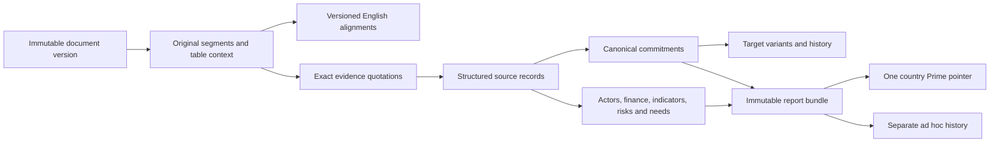

# Knowledge structure and labeling

> Method 3.0 supersedes the independent statement/phase/resilience dimensions and 40-topic catalogue described in this historical design. The implemented rules and 41-topic scope are in [METHODOLOGY.md](METHODOLOGY.md); canonical merging remains deferred. Historical design below is retained as background.

## Current implementation clarification

The [evidence experience](16-evidence-experience.md) uses the editable authoritative `config/v2/taxonomy.json`, `vocabulary.json` and `label-guide.json`, with definitions frozen in each saved profile. The hierarchy and independent facets below remain applicable. Canonical commitment entities, metric resolution and durable merge/revision ledgers described here are deferred architecture. Current views count source records and preserve all proposed duplicate/conflict links; they do not report deduplicated commitment totals.

> Engineering/design background. Current navigation, task controls and editable-source ownership are defined in [METHODOLOGY.md](METHODOLOGY.md), [document 14](14-lean-tools-translations-and-configuration.md) and [CUSTOMIZATION.md](CUSTOMIZATION.md). Earlier three/five-view and audience/length proposals below are historical; the current profile has Overview and Policy register.

Engineering specification v2, 8 October 2026. Built for the Climate and Disaster Resilience Team's country risk-profile analysis. This replaces the loose v1 record/label design for new implementation work. The v2 files are a prepared contract pack with offline checks, not a completed production pipeline or an accuracy benchmark.

## Core choice: a small hierarchy plus independent facets

Use **domain → topic**. Topic is the subdomain level; do not add a redundant “category” layer. Keep objective, record type, status, hazard, risk component, DRR phase and affected groups as independent labels. They answer different questions and should never compete in one dropdown.

The 40 stable topic IDs from the supplied design remain the starting vocabulary. Their definitions/routing are engineering proposals, not an official UNDP classification. `config/v2/taxonomy.json` is generated from the original pool, and `config/v2/vocabulary.json` defines the other facets. Unmapped evidence is retained and searchable rather than forced into Climate. The complete 40-topic dictionary is in `knowledge/topic-catalog.md`.

| Layer/facet | Meaning | Examples and rules |
|---|---|---|
| Domain | Broad sector/navigation grouping | Climate, Energy, Agriculture, Water, Biodiversity, Health, Urban, Waste, Transport, Industry, Tourism. Climate contains cross-sector planning, finance, data and warning topics; it is not a compulsory tag for every climate document. |
| Topic/subdomain | Specific policy area with a stable ID | AGR-01 irrigation efficiency; CLM-04 early warning/preparedness; WAT-03 flood/coastal protection. A topic can map to multiple domains. |
| Objective | Stated purpose | Adaptation, mitigation, disaster risk reduction, unspecified. More than one is allowed with evidence. |
| Record kind | What was extracted | Commitment, explicit priority, context, implementation observation, result observation. Only commitment records feed canonical commitment counts. |
| Assertion kind | How the source frames the statement | Planned, observed, projected, scenario, recommendation, historical, template, unclear. |
| Documentation status | Strength/type of documentary assertion | Mentioned, priority stated, action proposed/committed, implementation/result reported, unclear. Does not measure success. |
| Target | A structured object attached to an action | Quantity or qualitative deliverable plus baseline, unit, period, condition and scope. One commitment can have several scenario/version variants. |
| Hazard | Threat addressed or described | Flood, drought, heat, wildfire, storm, landslide, coastal hazards, compound hazards; other all-hazards terms where supplied. |
| Risk component | Part of risk being described | Hazard, exposure, vulnerability, capacity, impact, assessment, residual risk, systemic/cascading risk. |
| DRR phase | Stage of risk management | Risk understanding, prevention/reduction, preparedness, anticipatory action, response, recovery, cross-phase or unspecified. |
| Resilience function | Proposed analytical lens for capability | Anticipate, absorb, adapt, transform, recover, unspecified. This is an application vocabulary, not an asserted official taxonomy. |
| Cross-cutting tag | Theme spanning sectors | Finance, capacity, data, technology, gender, poverty, inequality, livelihoods, participation, just transition, transboundary issues. |
| Population/place | Whom/where the source explicitly concerns | Affected groups, named locations, national/subnational/regional/EU scope; do not infer benefits from a mention. |
| Policy instrument | Mechanism | Law, standard, investment, incentive, insurance, coordination, warning, research, training, ecosystem management, infrastructure/service. |
| Temporal role | Relationship between variants | Current, historical, superseded, parallel, unresolved. Established through reconciliation, not publication date alone. |

The focus on hazard, exposure, vulnerability and capacity follows the conceptual dimensions in [UNDRR's disaster-risk terminology](https://www.undrr.org/terminology/disaster-risk). The broader management lens is informed by the [Sendai Framework priorities](https://www.undrr.org/implementing-sendai-framework/what-sendai-framework), including risk understanding, governance, investment, preparedness and recovery. Our IDs and classification rules are local implementation choices; do not label them as certified Sendai mappings.

## Two ways to explore the same evidence

The default **sector lens** asks “What does the Water policy material contain?” The **risk and resilience lens** asks “Which flood-preparedness actions appear across Water, Urban, Health and Climate topics?” They filter the same records. No second extraction database or duplicate country report is needed.

Default filters: country, domain/topic, objective, hazard and target period. Show DRR phase, resilience function, population, actor, conditionality, instrument, source and status under More filters. An expert can save a view without running an LLM. Default sort uses transparent criteria such as source-stated priority, deadlines and explicit support needs; do not invent a country risk score or importance score.

## Entities and relationships

| Entity | Why it exists | Identity/provenance rule |
|---|---|---|
| Source blob | Exact file bytes | Content hash; original files remain available independent of the reading copy. |
| Document family/version | Instrument versus edition/revision | Family is semantic identity; each edition has its own file/version. Translations and policy revisions are different relationship types. |
| Source segment | Locatable prose/table/figure/footnote content | Source version + parser/config hash + locator. Original language and required context are preserved. |
| Translation | Complete English reading layer | Original segment hash + translation/glossary/model configuration. Official parallel edition links remain explicit. |
| Evidence | Exact support for a claim | Source segment, original quotation, deterministic location and table context. English is resolved through the stored alignment. |
| Source record | An atomic statement with attributes | Task-local proposal IDs become globally scoped IDs in application code; no source facts are overwritten. |
| Canonical commitment | One underlying promise across mentions | Application-owned durable identity ledger; translations/repeated mentions do not inflate counts. |
| Target variant | One quantity/deliverable with full meaning | Separate baselines, conditions, scenarios and periods; revisions link rather than erase earlier variants. |
| Typed details | Actor, finance, indicator, support or risk evidence | Attached to a record and optionally its target IDs, not a country-wide bag of unrelated facts. |
| Corpus snapshot | Exact input selection | Immutable document-version list, authority/role decisions, country/group and cutoff. |
| Run/artifact | Reproducible processing lineage | Input, prompt, schema, taxonomy, parser/translation config, model/effort and owner scope fingerprints. |
| Report bundle | Consistent output for every view | Manifest of immutable artifacts; source availability, automated eligibility and optional audit are distinct. |

The v2 JSON contracts and `architecture/v2/storage.sql` make these boundaries concrete. Persist additional event types for merges, splits, corrections and withdrawals as the runtime is built. JSON proposals do not assign trusted IDs or eligibility themselves.

## Record extraction is broader than targets

Capture qualitative actions and explicit priorities even when there is no number. Also retain risk assessments, vulnerabilities, institutions, implementation steps, barriers, support requests, financing distinctions, indicators, inclusion provisions and reported outcomes.

Keep actions separate from context and outcomes. “Flood exposure is increasing” is contextual evidence. “Create an exposure map” is a commitment. “Three maps were completed in 2024” is an implementation observation. “Expected result: maps completed by 2030” remains planned information. A flood map count is not a measure of reduced disaster loss.

For risk context, preserve: hazard wording, exposed assets/places, vulnerability drivers, stated capacities, consequences, likelihood/severity wording, assessment period and scenario. Preserve any original scale; do not invent probabilities, losses or scores. Link risk to an action only with explicit or inherited context. An earthquake in a ministry document is not automatically a climate hazard. All-hazards context can be useful to the team without changing the meaning of climate adaptation.

Use the chain **risk/context → action → intended result → population/place → indicator** where the source provides it. Missing links remain missing. Proposed causal explanations or programme ideas appear in a separately labelled ad hoc analytical output.

## Target contract

Every target can hold:

- original metric wording and candidate metric identifier;
- raw numeric token and lossless decimal-string value, range/comparator or qualitative deliverable;
- raw/candidate unit and desired direction;
- baseline value and period, target period, denominator and scenario;
- conditional/unconditional/not-stated/unclear status and exact condition;
- total versus additional interpretation;
- sector, gas, geographical, LULUCF and GWP/accounting scope;
- original evidence and reasons for material unknowns.

No universal metric registry can be inferred safely from display labels. Candidate metric/unit identifiers require a definition-aware resolver. Until then, comparable-looking targets remain descriptive. Do not numerically rank a BAU reduction against a historical reduction, combine EU totals with national allocations, or average conditional and unconditional targets.

Raw numeric text stays original. Normalization changes notation, not units or scale. `1 200,5` can become decimal string `1200.5` under a documented comma-decimal convention. Ambiguous `1,200` remains unresolved if context does not establish the convention. Textual numbers require a documented normalizer rather than an unverified decimal. Unknown is null, not zero. Full qualitative wording remains usable while a numeric normalization is unresolved.

## Labeling algorithm

1. Identify the reporting party, geography, document authority/version and language using source context.
2. Split meaningful source statements into actions/priorities/context/observations, preserving shared conditions and table headers.
3. Assign topic IDs under the fixed definitions. The application derives domains from their union; do not ask the model to regenerate domain names.
4. Assign independent objective, risk, DRR, resilience, group and instrument facets only where supported. Empty irrelevant arrays are valid; do not force every facet on every record.
5. Extract targets and typed linked details. Capture material unknowns and exact field support.
6. Validate allowed IDs, citations, numeric notation and internal links. Run source-oriented semantic/omission checks.
7. Reconcile duplicates, translations and revisions conservatively. Uncertain matches remain separate with a relation proposal.
8. Save labels with taxonomy/prompt versions. A later relabel task can reuse original evidence without retranslating all documents, but creates new derived versions.

An unmapped concept has its original term, evidence and proposed definition. It stays in reports/search, including exhaustive thematic searches. An optional taxonomy maintenance workflow consolidates proposals and versions new IDs. It is not a human approval gate for ordinary publication. Taxonomy changes must not silently rewrite old report labels.

## Worked example and counting

The invented Russian example in `examples/v2/` describes installing 20 flood early-warning systems by 2030, conditional on international financing, with a named lead ministry. It is not a real Kazakhstan claim.

| Field | Example classification |
|---|---|
| Domain/topic | Climate → CLM-04 early warning and disaster preparedness |
| Record/objective | Commitment; disaster risk reduction |
| Hazard/phase/function | Flood; preparedness; anticipate |
| Target | 20 systems; 2030; explicit financing condition; unknown baseline |
| Institution/support | Lead ministry linked to the action; financing need with no invented amount |
| Performance | Not assessed; no observation data supplied |

One promise repeated in three documents is one canonical commitment with three source occurrences. Two conditional scenarios are two variants of one commitment. One AGR-01 action can appear under Agriculture and Water but is counted once in the total. Domain totals may overlap and must not be added as if mutually exclusive. Report record counts, canonical commitment counts and variant counts separately.

## Language architecture

Keep source bytes and original Unicode text unchanged. Store language codes per document and segment because tables/annexes can mix languages. Keep source page numbering and physical PDF page index separately. Use identity alignment for English originals, verified official English segments when genuinely equivalent, and labelled machine translation otherwise.

Translate all selected content, not only retrieved quotations. Keep the original/English alignment, terminology decisions, edition authority, quality flags, model/configuration and hashes. Source revisions invalidate only affected translations/extractions; a glossary or translation-method change also changes the cache key. Normalization never replaces the raw quotation.

The user should open a target, see English, switch to the original passage/page, inspect surrounding table context, and identify the exact edition in one interaction. An official English edition that disagrees with the original remains visible as a conflict. English readability and original-language auditability are shared infrastructure for Prime and ad hoc, not separate features that can drift.

## Scope and limits

Prime initially covers the declared NDC/NAP collection and eligible annexes. It does not claim a full national disaster-risk assessment or every national disaster policy. Ad hoc uploads can extend analysis with disaster strategies, ministry plans and implementation evidence while retaining authority and scope labels. Optional later SDG/Sendai/GGA mappings need explicit versioned crosswalks and evidence; do not add inferred international indicator equivalence to the initial output.
