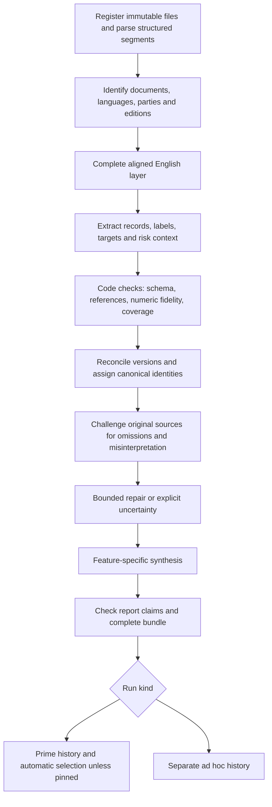

# Team tools and LLM pipelines

> Engineering/design background. Current navigation, task controls and editable-source ownership are defined in [METHODOLOGY.md](METHODOLOGY.md), [document 14](14-lean-tools-translations-and-configuration.md) and [CUSTOMIZATION.md](CUSTOMIZATION.md). Earlier three/five-view and audience/length proposals below are historical; the current profile has Overview and Policy register.

Engineering pack v2, 8 October 2026. Authoritative target for new implementation work alongside `09-knowledge-structure-and-labeling.md`. Prepared: prompts, generated schemas/vocabularies, machine-readable pipeline/tool/export blueprints, offline prompt composition and selected validators, synthetic examples and a tested storage blueprint. Not implemented: production provider dispatch, OCR/table workflow, complete translation/extraction orchestration, semantic quality workers, publication service or website UI. No country production or API spending was performed to prepare this pack.

## Team-facing tools

Provide one country workspace and one ad hoc workspace over the same evidence store.

| Tool/view | Expert use | Execution |
|---|---|---|
| Country overview and highlights | Understand priorities, risks addressed, commitments, deadlines and limitations quickly | Cached country synthesis; no LLM when opened |
| Commitments explorer | Track targets and qualitative actions by sector, objective, hazard, phase, actor and condition | Deterministic filters over canonical records |
| Risk and resilience explorer | Inspect hazards/exposure/vulnerability/capacity and prevention/preparedness/response/recovery actions | Same records with a different filter preset; no duplicate extraction |
| Implementation/support tables | Export actors, measures, costs, support needs, indicators and documented barriers | Typed detail links; JSON/CSV export without inference |
| Changes and alignment | Inspect revisions and NDC/NAP coherence with before/after evidence | Cached reconciliation findings |
| Bilingual evidence viewer | Move from English claim to original page/table/context | Stored immutable alignments; no fresh translation on each click |
| New operational report | Briefing, thematic analysis, comparison or programme/monitoring preparation | Reuse evidence; process only missing authorized sources; task-specific synthesis |
| Grounded report chat | Explain evidence, refine presentation and save an ad hoc version | Retrieval plus task prompt; exhaustive questions trigger full scoped jobs |
| Coverage and label inspection | Inspect parsing/translation/extraction gaps and unmapped concepts; optional audit | Stored diagnostics and versioned corrections; never a mandatory human gate |
| Run history and Prime selection | Resume failures, compare versions, pin/unpin country report | Application state only, not an LLM decision |

`config/v2/tools.json` describes the proposed application interface. It is not a list of deployed tools. Keep retrieval tools read-only if exposed to a model; job dispatch, publication and correction acceptance are application actions with explicit scope and identity.

## Outputs and presentation layers

Every report can offer the same three depths: five-minute overview, filtered structured records, and original evidence. Prime additionally has a shared country pointer; ad hoc results stay in their own history and can group several countries. Ad hoc dashboards are scoped to their chosen documents, not substitutes for the country's Prime.

Generate these from one bundle: dashboard JSON, short summary/highlights, full Markdown report, structured JSON/JSONL, source/translation manifests, and optional CSV/PDF exports. Table/filter views are deterministic. Any PDF is rendered from the same facts, not independently regenerated by another prompt. For multi-country ad hoc work, provide a comparison/overview and per-country dashboard slices with explicit source coverage; do not mislabel a combined target as belonging to each country.

`config/v2/exports.json` lists bundle artifacts. Large originals/translations remain immutable shared files addressed by hash; report manifests reference them. A bundle does not need to duplicate every translated page. All view responses carry the same report/release ID so a dashboard cannot show one version's summary beside another's targets.

## Shared pipeline

One country run is a resumable workflow, not one enormous context window. The common pipeline is declared in `config/v2/pipelines.json`. For existing compatible evidence, reuse completed stages; do not retranslate or re-extract merely to write a different brief.

## Prompt and output routing

Every request gets `00-evidence-contract.md`, `01-labeling-rules.md`, exactly one task prompt, its schema, selected vocabulary and bounded source/task inputs. The application supplies trusted scope controls; document text and user report questions remain data and cannot grant publication privileges.

| Route | Task prompt in prompts/v2 | JSON schema in schemas/v2 | Run boundary |
|---|---|---|---|
| Triage | 02-triage.md | triage | Document preview/metadata; proposals only |
| Translate | 03-translate.md | translation | Owned segments plus neighboring/table context |
| Extract | 04-extract.md | extraction | All owned source segments, including meaningful non-target evidence |
| Relabel | 05-relabel.md | labels | Existing records plus originals under a new taxonomy |
| Reconcile | 06-reconcile.md | reconciliation | Document-family/country evidence, conservative groups and variants |
| Quality | 07-quality.md | quality | Source coverage, translation, reconciliation or final claims |
| Prime | 08-prime-report.md | report | One curated country snapshot; required sections |
| Briefing | 09-briefing.md | report | Selected sources, audience and length |
| Focused analysis | 10-focused-analysis.md | report | Complete selected scope for exhaustive requests |
| Comparison | 11-comparison.md | comparison | Frozen explicit groups and comparable dimensions |
| Programme/monitoring preparation | 12-workplan.md | workplan | Commitments plus typed actors, finance and indicators |
| Chat | 13-chat.md | chat | Authorized frozen report plus retrieval and bounded conversation |

Additional server-owned contracts: document-version, source-segment, canonical-commitment, run-request, release and dashboard. Models do not create trusted hashes, reviewer identities, immutable IDs or publication receipts. The initial dashboard contract only allows `not_assessed` performance; actual monitoring needs a separate observation/method contract.

## What each Prime function costs

| Prime function | Reused evidence/output | Additional model work |
|---|---|---|
| Summary/highlights | Canonical commitments, risk context, typed support information, coverage and changes | Country synthesis and claim challenge |
| Policy/target tracker | Canonical records and target variants | No separate full extraction; deterministic projection |
| Risk/resilience lens | Risk contexts and hazard/phase/function facets | Included in extraction and synthesis; filters need none |
| Implementation/support | Actors, finance, indicators and needs attached to actions | Included in synthesis; detailed tables need none |
| Changes/NDC–NAP alignment | Document relationships and reconciliation | Reconciliation/challenge once per changed country snapshot |
| Sources/translations/audit | Original segments, aligned English and provenance | Translation once per source/configuration; browsing needs none |

All belong to one Prime bundle with three main tabs. Do not create independent Prime states for each function. Cross-country comparison is initially ad hoc; one later regional matrix can reuse all selected Prime bundles without 18 all-document rereads.

## Request assembly and context management

Use `policytracker.engineering.compose_v2` to produce instructions, JSON input, output schema and component/input hashes. It makes no provider call. Each transport checks the authenticated model/effort capability and negotiates the actual structured-output contract. Preserve Astra/xhigh for the requested initial run. ChatGPT account, application-owned plan usage and API remain separate adapters with consistent task semantics; a local login does not create a hosted website integration.

Use strict structured output when supported. Unknown values are nullable and objects reject extra keys. The schema is generated from one source file to reduce drift. Validate locally even when provider structure enforcement succeeds: well-formed JSON can still contain wrong facts. [OpenAI structured-output guidance](https://developers.openai.com/api/docs/guides/structured-outputs).

Keep common instructions stable, task-specific instructions concise, and context separate. Include representative boundary examples and version prompts/configuration alongside code. This follows the general approach in [OpenAI prompt-engineering guidance](https://developers.openai.com/api/docs/guides/prompt-engineering). The model-specific Astra Markdown guidance could not be fetched through the web reader; the bundled prompting reference was used only for supplementary style/autonomy guidance. No unverified model limit or pricing claim is built into this pack.

Set request budgets from measured tokens and actual route limits, not an arbitrary page count. Reserve room for structured output and context. A table may need multiple owned row groups with duplicated header/footnote context. Assign every content segment to one owning task; context copies are not counted twice. If a task cannot fit, partition with complete ownership accounting. Do not silently drop middle pages.

For extraction, every relevant segment is visited. For synthesis, partition validated evidence by section/topic when necessary, create cited intermediate findings, and verify the final report covers each required section and planned commitment set. Retrieve original neighboring context for disputed claims. Top-k retrieval alone cannot answer “extract every commitment.” For reconciliation, partitions propose groups with a later cross-partition candidate check; no universal embedding threshold may merge promises.

## Validation and automated completion

Use four separate layers:

1. **Structural:** schema, enums, required sections, unique IDs, legal references and scope membership.
2. **Deterministic evidence:** quotation resolution, source hashes, field pointers, numeric token normalization, owned-segment accounting, complete artifact hashes and translation alignment coverage.
3. **Semantic challenge:** original-language conditions, table interpretation, attribution, omitted actions, false merges and unsupported synthesis. Check source segments without records as well as successful extractions. Model agreement is not proof of accuracy.
4. **Publication:** internally stored receipt tied to the full immutable bundle, correct run/country/corpus generation, current pin state and atomic history/pointer transaction.

The offline `validate_v2` currently implements only selected checks in layers 1–2. It does not prove field entailment, all-field support completeness, omission recall, translation fidelity or access control, and it cannot issue a publication receipt. Remaining worker/service checks are explicit implementation tasks.

Limit repairs to two attempts per task initially. Repair the affected extraction/translation or report section with original evidence; do not keep appending conflicting JSON. Unresolved source ambiguity becomes unknowns, separated variants or disclosed limitations. Remove unsupported interpretations before publication. Failed/incomplete tasks remain retryable and cannot replace a working Prime. Partial source availability is distinct from a crashed workflow.

Publish successful eligible results automatically. No human reviewer is required. Show AI-generated, automated-check status, optional audit state, source dates and limitations separately. Pinning freezes the selected immutable report while new successful runs remain visible in country history. Unpinning chooses the latest eligible successful run. Submission sequence and corpus generation prevent a slow older run from replacing a newer result. Audit corrections produce new validated artifacts, never silent edits.

## Cache, cost and operational controls

Artifact cache keys include source/content hashes, parser/OCR config, glossary/translation version, prompt/schema/taxonomy versions, model/effort/route, selected options and access scope. Preserve stage-level provenance when reusing artifacts. A report may legitimately combine an older unchanged translation with a new synthesis; do not stamp the whole bundle as if every stage ran with the latest model.

Start with one worker and concurrency one until route quotas and memory are measured. Checkpoint each owned segment batch, retain attempt/error/request IDs, and expose resume/cancel. Account quotas and API dollar budgets are separate. Do not fall back to a paid API or cheaper model silently. Reserve estimated cost before API dispatch, record usage and retries, and respect provider-level limits; no invented full-corpus price is supplied.

New document → new immutable source version → process changed content → reconcile country → regenerate affected report views → automatic/pinned publication rule. Ordinary dashboard reads, filter changes, evidence inspection, saved views and exports need no model. Optional reanalysis after taxonomy/model changes is an explicit run with its own history, not a periodic automatic refresh.

## Chat and ad hoc personalization

Five controls: template, sources/groups, focus, audience and length, plus optional instructions. Model/effort/route is one shared settings panel. A structured report brief stores those settings and confirmed intent. Keep recent turns plus a cited summary; do not inject the entire accumulated chat into every extraction task.

Chat can explain evidence, adjust a brief, request a comparison or save a new ad hoc version. It cannot change source truth, broaden document access or publish Prime. New sources are visibly added to the report scope before processing. Multi-country inputs get explicit groups; translations are linked editions rather than duplicate commitments. Wrong/unrelated documents produce a visible disposition. Prime permissions do not expose another user's private uploads.

## Evaluation and implementation sequence

Synthetic fixtures test known failures, not country accuracy. The current Russian/English example exercises a conditional flood-warning target, actor, support need and preparedness labels. Add real retained cases for every language, table layout, condition, hazard/phase and rare/unmapped topic during production calibration. Keep families/translations together when splitting evaluation data. Do not claim >95% recall without a credible reference set; optional human labels can improve future evaluation without blocking publication.

Implement in this order:

1. Immutable source/translation storage, owned-segment parsing/OCR and v2 schema validation.
2. A real selected-model canary and resumable translation/extraction worker, with usage/provenance.
3. Canonical identity ledger, source-oriented challenge/repair, one complete KAZ bundle and difficult multilingual/table/EU cases.
4. Internal bundle validation and automatic/pinned release service; export integration with the existing country page.
5. Batch the supplied corpus, then expose the four ad hoc templates, shared evidence tools and grounded chat.

Do not apply `architecture/v2/storage.sql` over the earlier registry as a blind migration. v1 remains legacy reference material; new workers should target v2. Run `scripts/check_v2_pack.py` and the v2 tests for contract changes. The original inventory cache overwrite defect and incomplete production providers remain separate work until the real runtime migrates.
