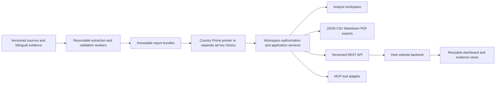

# Portable reporting, API and plugin architecture

Design baseline, 8 October 2026. Website independent. The example website in the request is illustrative; this pack neither contacts nor modifies it. API and MCP files are contracts, not deployed servers. The reference JavaScript client and data-only dashboard component are implemented locally.

## One analysis core, several delivery channels

Use a modular service and a background worker initially, not separate microservices for every feature. Parsing, translation, extraction and synthesis remain the v2 pipeline. The publication service stores artifacts and switches one country pointer atomically. Adapters retrieve the same validated records; they do not summarize again, translate again or maintain competing Prime states. Ordinary reads, filtering and rendering exports require no inference credentials.

| Integration path | Best initial use | Contract |
|---|---|---|
| Static bundle | Colleague imports results into any existing site or analysis workflow | Manifest, immutable IDs/hashes, v2 JSON, normalized CSV tables, readable Markdown/PDF |
| REST API | Keep a website current and enable operations from another app | [OpenAPI](../integrations/api/openapi.json), workspace scope, frozen bundle reads, asynchronous explicit runs |
| Web component | Reuse a compact tracker without adopting our whole UI | `.data` accepts an authorized v2 dashboard; emits evidence events; CSS theme variables |
| MCP connector | Let an AI client find/read reports and inspect their evidence | Ten default read-only tools; optional separately enabled ad hoc generation |

Start with static exports and the read API/component. Add workflow endpoints and the MCP adapter over those same application services. An iframe is optional later for teams without frontend capacity; it would require a hosted read-only view, approved embed origins/CSP and short-lived scoped access. Do not create a separate iframe data model or put bearer tokens in URLs.

## Bundle identity and refresh

Resolve `GET /v1/workspaces/{workspace_id}/countries/{country_code}/prime` once, retain its `release_id`, then retrieve all report sections from `/bundles/{bundle_id}/...` using that ID. In this contract a bundle ID and a v2 release ID refer to the same frozen report. This avoids mixing an old summary with a new target register if Prime changes mid-session. `release_id: null` is a valid no-Prime state.

The country pointer has mode, revision, corpus generation and a pending-source-update flag. Pin/unpin uses `If-Match` with its ETag; an outdated write returns 412. Automatic selection uses eligible corpus/submission ordering rather than worker completion time. A completed old job must not undo a newer result or an intervening pin. The UI offers a refresh when a newer selected version exists; it does not swap evidence while the analyst reads it.

Private responses use access-aware ETags and `Cache-Control: private`; original passages and expiring links should normally be `no-store`. Never put private responses in a shared unauthenticated CDN cache. Cache authorized representations by workspace, access scope and bundle/schema version. Revocation/withdrawal must take effect at the authorization layer even if immutable bytes still exist. A static export is a snapshot and cannot promise live revocation after download; its manifest must state date/scope and redistribution restrictions where applicable.

An event cursor endpoint is specified for `prime.changed`, bundle availability/withdrawal and run events. Clients deduplicate by event ID and re-read the authorized pointer after a change. Cursor expiry should return an explicit resync-required error rather than omit events. Webhooks can be added later using a transactional outbox, signed payloads, timestamp/replay checks and deduplicated retries; they are not currently in the OpenAPI pack.

## Authorization and provider separation

There are three distinct identities: the PolicyTracker user/team, an external application's scoped service identity, and the user's authorized inference connection. An external website receives PolicyTracker access, not the user's ChatGPT session or API secret. Reading published workspace reports never requires connecting a model account.

Automatic publication means available to the existing workspace audience. It does not mean public internet publication. Initially every signed-in team member can initiate eligible Prime updates and pin/unpin, matching the user's decision. Private ad hoc uploads/results retain their separate audience. Service tokens start with read permissions; generation, source access and Prime selection are independent scopes. No routine human report review is introduced.

The server must resolve workspace membership from authentication; `{workspace_id}` is never trusted authorization. Check access again for every bundle, document, evidence ID, export, event and chat retrieval. Reports may contain quotations, so source permissions must be applied to all representations, not just the source endpoint. Use nullable/redacted evidence and explicit limitations where appropriate; when a synthesis cannot safely be separated from restricted content, deny that artifact rather than leaking it through summary text.

`x-required-scopes` in OpenAPI documents required permissions; a bearer scheme or MCP annotation does not enforce them. Extra semantic checks include `prime:write` for Prime snapshots/runs, `sources:read` plus redistribution rights for original-inclusive exports, run ownership for cancel/resume, and compatible source-country/instrument checks. A caller cannot mark its own output eligible or substitute an arbitrary model connection.

For private website integration, use the host backend as a proxy: browser → host session → authorized service call → filtered JSON. Keep long-lived tokens server-side; allowlist browser origins, use secure same-site sessions and CSRF protection for mutations. Do not render PDF text as HTML, run embedded scripts, or follow document instructions. Signed source/download URLs must be short-lived and bound to the authorized artifact; logs must exclude credentials and private source text.

The current SQLite blueprint is **single-workspace reference storage**. For an initial hosted pilot, isolate each workspace's database, object prefix and jobs. Before a shared multi-tenant database, include workspace ID in every relevant key, foreign key, query, cache key and job claim and verify cross-tenant negative tests. Adding a workspace URL parameter alone does not provide isolation.

Account execution needs a supported, verified transport. A local authenticated Codex catalog entry is not a transferable website login or a deployed OAuth integration. The capabilities endpoint reports actual usable connection/model/effort combinations. User-owned local execution and hosted API workers may expose the same job interface while retaining different credential/storage boundaries. Never copy local account tokens to a hosted service or silently switch routes when unavailable. Existing account/API limitations are detailed in [document 3](03-llm-engineering-and-auth.md).

## API behavior

The prepared contract covers 31 operations: country/history/pointer; artifact metadata, dashboard, report, comparison and workplan; filtered records and bilingual evidence; exports; uploads/documents/snapshots; runs/cancel/resume/capabilities; grounded chat; optional annotations; and changes. OpenAPI 3.1.1 is intentionally pinned for this design, separately from API v1 and knowledge schema v2. It is not a claim to be the latest specification. [Official OpenAPI specification](https://spec.openapis.org/oas/v3.1.1.html).

POST operations require an idempotency key. Repeating the same key and normalized body in the same workspace/actor/operation returns the existing result; a changed body returns 409. For a run, the header must match `request.idempotency_key`; reject disagreement before dispatch. Store idempotency results durably for the supported retry window, with an explicit expired-key policy. Reconnecting or polling never creates a second model job.

Generation/chat return 202 with a job URL; completion points to an immutable bundle or chat-reply resource. Upload inspection can return 202 with a document inspection URL. Reads, upload inspection and export rendering do not silently launch a paid model. Pause a workflow if inspection requires LLM processing until an explicit authorized run. Deterministic OCR can proceed as configured infrastructure work.

Requests validate both structure and semantics: authorized source groups, declared model/effort, workspace-bound inference connection, route agreement, coverage and current source generation. IDs and free-text schema fields remain subject to application validation. Empty/unreadable inputs do not yield a fabricated successful report. The JSON contract intentionally does not prove these runtime properties.

Record filters use AND across facets and OR within comma-separated values. Stable cursor pagination includes bundle ID, normalized filters, sort and authorization scope; incompatible cursors return 400. Count metadata distinguishes canonical commitments from source records. Multi-country bundles require an explicit country slice for dashboard views. Ad hoc report lists never mix in country Prime history. Missing optional artifact types return a specific unavailable-artifact error.

Operational defaults: one extraction worker initially, stage checkpoints, bounded retries, run cancellation/resume, per-user concurrency and explicit account/API budgets. Report access and generation quotas are separate. Correlation IDs connect HTTP request, job, stage, provider request and artifact; do not log raw tokens, prompts containing private evidence, or credential values. Track failure rates, stage duration, coverage, usage and cache reuse without claiming an exact full-corpus cost before measurement.

## Exports and plugins

Export JSON is canonical and preserves arrays and provenance. CSV exports should be related tables (records, labels, evidence links, targets, actors, finance), with stable joining IDs, UTF-8 and spreadsheet-formula injection protection. Include a README/data dictionary and checksums. Human reports/PDFs render the stored report model; they must not perform another fact-generating LLM pass. Export full versus filtered scope explicitly, and never label a filtered download as a complete country report. Original-document inclusion is a separate authorized option. PDF/CSV export services are specified, not implemented in this turn.

The default MCP pack exposes ten read tools, mapped to API operation IDs. Tool schemas/annotations describe behavior; authorization remains in the application service. Exclude Prime mutation and arbitrary SQL/files/network tools. The optional run tool is disabled by default, limited to ad hoc/comparison, and requires explicit selected model/effort, connection and idempotency. Tools should return structured output with compact cited text and authorized links; page records rather than placing whole reports in every model context. Follow the [MCP tools specification](https://modelcontextprotocol.io/specification/2025-11-25/server/tools).

A remote MCP server needs the protocol's supported authorization flow and token audience/scope validation; a JSON tool catalog alone is not a working ChatGPT plugin. Use official client-supported registration when implementing, with revocable connections and no token passthrough to unrelated services. [MCP authorization specification](https://modelcontextprotocol.io/specification/2025-11-25/basic/authorization).

## Engineer handoff and acceptance

Prepared folders: `design/` for interaction/tokens/prototype; `integrations/api/` for the API contract; `integrations/javascript/` for the client and component; `integrations/mcp/` for connector definitions; `integrations/fixtures/` for explicitly synthetic payloads. Existing `src/`, `prompts/v2/`, `schemas/v2/` and `config/v2/` own the analysis contracts. Do not fork these definitions for each host website.

Production acceptance must exercise: cross-workspace/source denial; original redaction across every endpoint; one frozen bundle throughout a page; two simultaneous pin writes; older job finishing later; duplicated run dispatch; failed generation preserving Prime; expired credentials with no fallback; private ad hoc isolation; proper multi-country attribution; cancellation/resume; evidence escaping; external component keyboard/responsive behavior; and export ID/hash integrity. Contract checks and the synthetic prototype do not establish these service guarantees.

Implement in order: validated bundle/static export → read API and reference host integration → automatic/pinned service plus updates → ad hoc jobs/chat → MCP connector. This preserves the priority of first producing usable country analyses while making every later interface reuse the same evidence.
